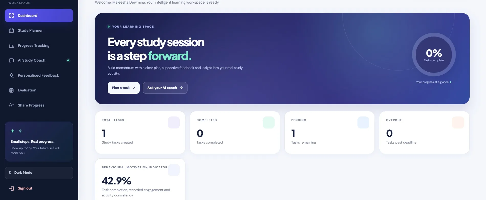
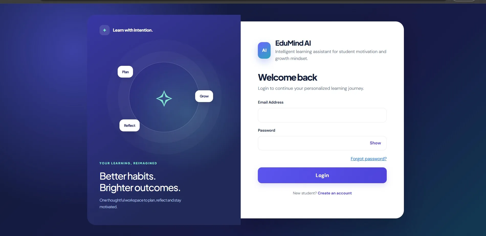
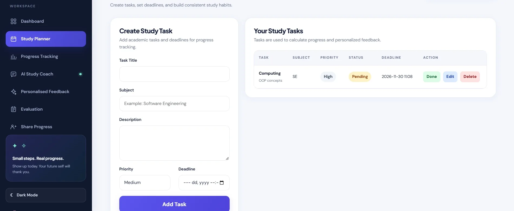
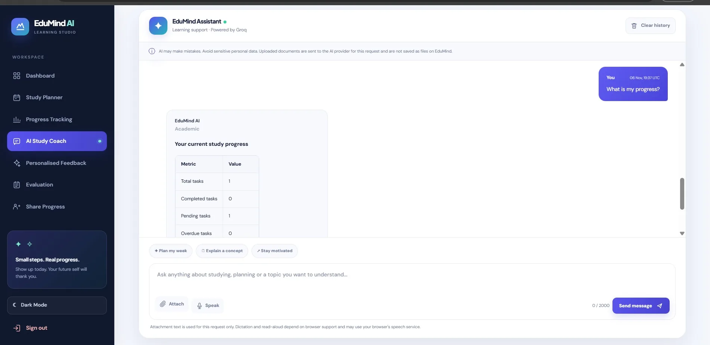
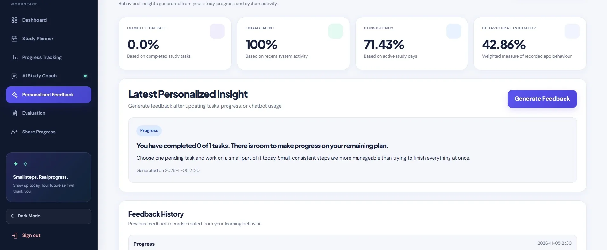
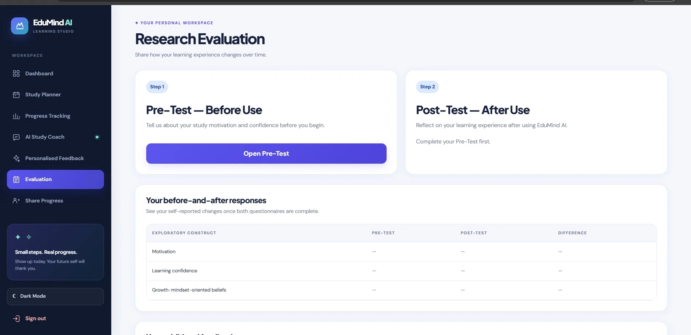
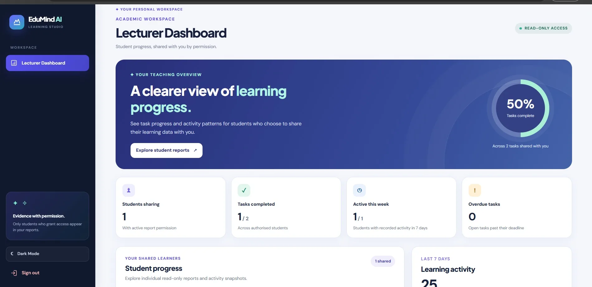

# EduMind AI — Intelligent Learning Assistant

**A full-stack learning support platform combining study planning, progress insights, conversational AI, and personalised feedback.**

Built as a final-year **BEng (Hons) Software Engineering** project at London Metropolitan University.

[Explore the live application](https://edumind-ai-project.alwaysdata.net/auth/login) · [Browse the source code](https://github.com/MaleeshaDewmina/EduMindAI-Learning-Assistant) · [Development notes](docs/development-notes/README.md)

  

## Overview

EduMind AI brings everyday study-support tools into one web application. Students can organise academic tasks, monitor recorded progress, interact with an AI study coach, and receive practical feedback based on their activity within the platform.

The application also includes a research questionnaire workflow, consent-controlled Lecturer reporting, and role-specific administrative functions.

### Main features

| Area | Functionality |
| --- | --- |
| **Study Planner** | Create, edit, prioritise, complete, and manage academic tasks and deadlines. |
| **Progress Dashboard** | Review task statistics, recent activity, visual summaries, and a clearly labelled behavioural indicator. |
| **AI Study Coach** | Conversational learning assistance using the Groq API, with conversation controls and supported document context. |
| **Personalised Feedback** | Practical, rule-based suggestions informed by recorded task completion and learning activity. |
| **Research Evaluation** | Structured pre-test and post-test questionnaire workflow with individual response storage. |
| **Lecturer Workspace** | Read-only student progress reports, available only through explicit student-controlled sharing permissions. |
| **Account Management** | Distinct Student, Lecturer, Administrator, and Super Administrator privileges. |
| **Account Security** | Password hashing, CSRF protection, access checks, login protections, and secure password-recovery workflows. |

## Screenshots

A selection of screens from the finished application. The images show demonstration interfaces; personal account details have been omitted.

<table>
<tr>
<td width="50%"> <strong>Welcome &amp; sign in</strong></td>
<td width="50%"> <strong>Study Planner</strong></td>
</tr>
<tr>
<td> <strong>AI Study Coach</strong></td>
<td> <strong>Personalised Feedback</strong></td>
</tr>
<tr>
<td> <strong>Research Evaluation</strong></td>
<td> <strong>Lecturer Dashboard</strong></td>
</tr>
</table>

## Technology stack

| Layer | Technologies |
| --- | --- |
| Backend | Python, Flask, Flask-Login, Flask-WTF |
| Frontend | HTML, CSS, JavaScript, Jinja2, Bootstrap, Chart.js |
| Database | MySQL, SQLAlchemy, PyMySQL |
| AI integration | Groq API |
| Hosting | alwaysdata (Python/WSGI), Aiven MySQL |
| Testing | pytest, Postman |
| Development workflow | Git, GitHub, Visual Studio Code |

### Architecture

The application follows a modular Flask structure, separating route handlers, database models, services, templates, and static assets.

    app/
    ├── models/           # Users, tasks, activity, evaluation, permissions
    ├── routes/           # Auth, planner, dashboard, chatbot, reporting
    ├── services/         # AI, analytics, recommendations, email
    ├── templates/        # Student, Lecturer, and Admin interfaces
    └── static/           # Stylesheets, JavaScript, icons
    database/             # Schema changes and SQL migration scripts
    docs/                 # Technical and development documentation
    scripts/              # Operator utilities
    tests/                # Automated regression tests
    config.py
    requirements.txt
    run.py

## Run locally

**Requirements:** Python 3.12+, MySQL, and a compatible Python environment.

1. Clone this repository and enter the project directory:

       git clone https://github.com/MaleeshaDewmina/EduMindAI-Learning-Assistant.git
       cd EduMindAI-Learning-Assistant

2. Create a virtual environment and install dependencies:

       python -m venv .venv
       python -m pip install -r requirements.txt

   Activate the virtual environment first where appropriate (Windows PowerShell: .venv\Scripts\Activate.ps1; macOS/Linux: source .venv/bin/activate).

3. Copy .env.example to .env. Configure the local MySQL connection and generate a unique secret key:

       python -c "import secrets; print(secrets.token_hex(32))"

   Place the generated value in SECRET_KEY. Do not commit or publish the .env file.

4. Create an empty MySQL database and, for a **new local database only**, initialise the SQLAlchemy models:

       python -c "from app import create_app; from app.extensions import db; app=create_app(); ctx=app.app_context(); ctx.push(); db.create_all(); ctx.pop()"

   The SQL migration scripts under database/ support upgrading earlier schemas; do not run them blindly against an existing database.

5. Start the application:

       python run.py

   The site is served locally by the development server. Configure GROQ_API_KEY for AI replies and the email settings for delivery-dependent features.

### Run the tests

    python -m pip install pytest
    python -m pytest tests -q

The **latest documented complete regression run** recorded **105 passing tests across 14 modules**. The tests use isolated fixtures and are separate from the hosted research database. Refer to the actual test output for a particular revision when reporting fresh results.

## Evaluation and engineering outcomes

The project included an exploratory paired questionnaire evaluation with **87 retained participant records**, alongside system-level verification. Results are documented as observed self-report differences, not proof that the application caused psychological changes.

The development demonstrates practical integration of a Flask web application, relational persistence, external AI and email services, role-based permissions, cloud hosting, and automated software verification.

## Documentation

- [Development notes archive](docs/development-notes/README.md) — preserved phase-by-phase implementation notes.
- [Secure email and account recovery](docs/PHASE10_EMAIL_RECOVERY_AND_REPORTS.md)
- [Administrative account setup](docs/SUPERADMIN_SETUP.md)
- [Lecturer reporting use cases](docs/lecturer_use_cases_phase9.md)
- [Screenshot information](docs/screenshots/README.md)

## Notes

- This is an academic software engineering prototype, not an institutional production service.
- The AI coach supplements independent learning; model-generated answers should be verified where appropriate.
- Repository examples must not include live credentials, private account data, participant identities, or questionnaire exports.
- An explicit software licence has not been assigned to this repository.

---

**Developed by [Maleesha Dewmina Perera](https://github.com/MaleeshaDewmina).**